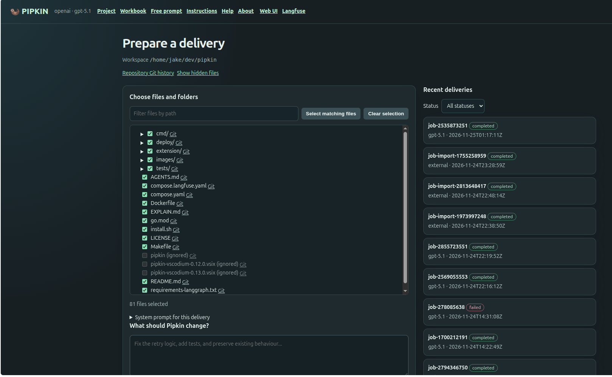
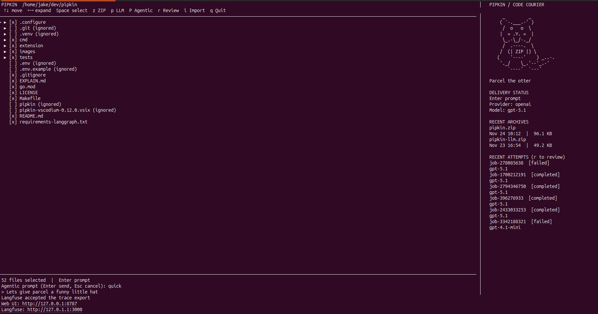
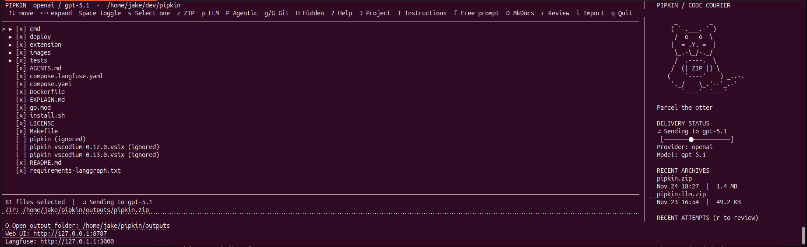
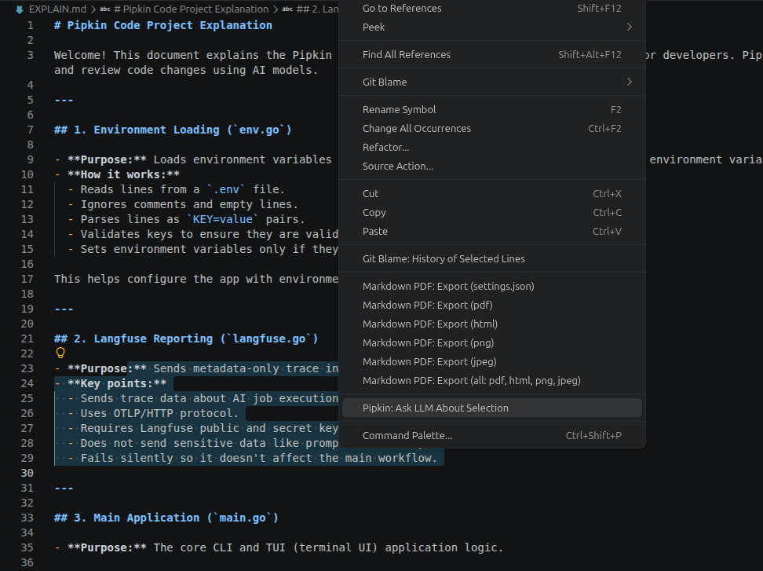

# 🦦 Pipkin

**Understand, update, and maintain large codebases with local models and reviewable diffs.**

Pipkin is an open-source tool for working on a large repository one focused task at a time. Select a file, directory, or snippet, then ask a model running locally through vLLM to explain it or propose a change. A hosted model is an option when you need one.

- **Choose the context.** Send the files relevant to the task so you can work on a large codebase without sending the whole repository on every request. For a question about a few lines, send a snippet.
- **Review before applying.** Pipkin saves the original selection, prompt, and result. Compare the returned files with the submitted ZIP or your current workspace, approve changes file by file, and apply them when you’re ready.
- **Spend tokens deliberately.** Start with one pass. Opt into draft and review passes for harder changes. Text requests keep stable file context ahead of the task to help providers that support prefix caching, and Pipkin records reported token usage.

I built Pipkin after a few tools I’d written turned into a Rube Goldberg machine. I wanted the same workflow in a terminal, browser, and VSCodium. **Parcel** is the otter who carries the ZIP.

Yes, this does involve reading a diff. We appreciate your patience with this legacy workflow. In recognition of this inconvenience, we’ve provided a TUI and an animal mascot.


## Build and install

```sh

make test
make   # builds and installs Pipkin and the VSCodium extension
```

## Download or run in Docker

Download a Linux or macOS binary from [GitHub Releases](https://github.com/JakeKalstad/pipkin/releases), or install the latest release into `~/.local/bin`:

```sh
curl -fsSL https://github.com/JakeKalstad/pipkin/releases/latest/download/install.sh | sh
```

For a browser-based setup, run `docker compose up -d pipkin` from the repository checkout. See [Deploy Pipkin](deploy/README.md) for mounting a workspace, building locally, and adding vLLM, LangGraph, or Langfuse.

## Quick start with a local model

With Pipkin installed and your vLLM server running, create `~/.config/pipkin/config.json` or merge these fields into your existing config:

```json
{
  "provider": "vllm",
  "base_url": "http://127.0.0.1:8000/v1",
  "model": "your-served-model"
}
```

Use your server’s port and exact served model ID. If it requires authentication, set `"api_key_env": "VLLM_API_KEY"` and add the key to your Pipkin `.env`. A loopback server without authentication needs no API key.

Run `pipkin` from your project directory. Select the files you want the model to see, press `p` to send a prompt, and press `r` to review the delivery. In VSCodium, highlight code and run **Pipkin: Ask LLM About Selection** to ask a question without applying any changes.

## End-to-end tests

Run `make test-e2e` on a Unix host with Python 3 and `stty`. The suite exercises the terminal, web, snippet, and MCP entry points with temporary workspaces and local mock providers. No API keys or hosted services are required.

## Configure

Provider settings live in `~/.config/pipkin/config.json`. Set `PIPKIN_CONFIG` to use a different file. See [Switch between model providers](#switch-between-model-providers) for OpenAI, Grok, Claude, DigitalOcean, and vLLM profiles.

For API keys and optional settings such as the web UI and Langfuse, use a Pipkin environment file.

```sh
mkdir -p ~/.config/pipkin
cp -n .env.example ~/.config/pipkin/.env
chmod 600 ~/.config/pipkin/.env
```

Pipkin loads the home `.env` and then the current directory’s `.env`. Exported variables take precedence, followed by the home file. To load a specific file, export `PIPKIN_ENV_FILE=/path/to/.env` before launching Pipkin. The parser accepts `KEY=value`, optional `export`, quotes, and comments. Keep keys outside version control.

## Optional web interface

Set in your `.env`:

```dotenv

LISTEN_URL=http://127.0.0.1:8787
```

Start the standalone web interface:

```sh

pipkin --web
```

Visit <http://127.0.0.1:8787>. You can also run `pipkin` normally; it starts the web viewer alongside the interactive TUI when `LISTEN_URL` is set.

The Go `html/template` interface offers a recursive file/directory picker, prompt submission, saved deliveries, and highlighted unified diffs comparing the result with the submitted ZIP or the current workspace. Approve or reject each proposed file, then explicitly **Copy approved changes** to your working tree. Copying uses the same hash checks, conflict protection, and backups as the TUI. The browser runs only on loopback, uses per-process form tokens, and must not be exposed publicly without authentication. LLM submissions run in the background while the browser stays responsive.




With `LISTEN_URL`, `langfuse_url`, or `LANGFUSE_BASE_URL` configured, Pipkin displays the corresponding service links in the web header and the terminal picker. Terminals that support OSC 8 make the displayed URLs clickable.

## Web HTTP API

Start with `pipkin --web` and the loopback `LISTEN_URL` shown above. These endpoints serve HTML and accept URL-encoded form data. For every POST, include the `csrf` token from the hidden field on the landing or review page. Successful POSTs return `303 See Other`.

| Method and path | Parameters | Behaviour |
| --- | --- | --- |
| `GET /` | — | Show the workspace file picker and saved deliveries. |
| `POST /submit` | `prompt`, repeated `files` fields, optional `agentic=1` | Start a delivery in the background. Refresh the landing page for its status. |
| `GET /review` | `job`, optional `mode=submitted\|current` | Show delivery status or compare the result with the submitted ZIP or current workspace. The default is `submitted`. |
| `POST /decision` | `job`, `action`, `path` for a single file, optional `mode` | Save a decision. Actions are `approve`, `reject`, `reset`, `approve-all`, and `reject-all`. |
| `POST /copy` | `job`, `confirm=COPY` | Copy approved files into the working tree. Returns `409` if a decision is pending or a workspace conflict blocks copying. |

The web endpoints use a `job` value of the form `PROJECT/JOB-ID`. Use the value from the delivery’s review link.

## MCP

See? We don’t hate agentic development. We just like reading the code sometimes.

Configure your MCP client to launch the local stdio server. Use the full path to the Pipkin executable if your client has a different `PATH`.

- **Command** `pipkin`
- **Arguments** `["--mcp"]`
- **Transport** stdio

| Tool | Required arguments | Result |
| --- | --- | --- |
| `pipkin_pack` | `root`, `paths` | Creates a ZIP and returns its path and file count. |
| `pipkin_submit` | `root`, `paths`, `prompt` | Sends the selection to the configured provider and returns the saved job directory and result ZIP. |
| `pipkin_jobs` | `root` | Lists saved job directories for the project. |
| `pipkin_review` | `job` | Returns the saved job’s file changes for inspection. |
| `pipkin_apply` | `job`, `file` | Applies one reviewed file. Requires `PIPKIN_MCP_ALLOW_APPLY=1` in the server’s environment. |

Use absolute paths for `root` and `job`. Use project-relative paths for the `paths` array and the `file` argument. A typical session runs `pipkin_submit` → `pipkin_review`, then applies selected changes through a review interface or the opt-in MCP apply tool.

## Troubleshooting deliveries

- **Wrong model or provider in the TUI** means Pipkin loaded different settings than you expected. `make` installs the binary and extension. Provider settings are read from `PIPKIN_CONFIG` or `~/.config/pipkin/config.json` at startup. For named profiles, check `pipkin --provider-profiles`. Without a named profile, `PIPKIN_MODEL` and then `OPENAI_MODEL` take precedence over the configured model. Use an API model ID supported by the selected provider and restart Pipkin after editing the settings.
- **A selected file is missing from the model context** can occur with any text provider. Pipkin sends a text subset of the selected ZIP, limited to 50,000 bytes per file and `max_context_bytes` total (160,000 by default). Omitted paths are listed in the web review and in the delivery's `job.json` under `context_omitted`. Select only the files relevant to the task, or use `openai-archive` to send the selected ZIP as an attachment.
- **Provider returned identical files** means the result ZIP has the same paths and file contents as the selection you sent. Check that the selection includes the files your prompt asks to change and state the expected edit explicitly. For agentic jobs, compare the saved `input.zip`, `draft.zip`, and `result.zip` to see which pass returned the unchanged files.
- **Langfuse** requires a base URL and the project’s public and secret keys. Set `LANGFUSE_BASE_URL` in your Pipkin `.env`, or set `langfuse_url` in the provider config. Pipkin reports export status after the delivery in the TUI, the web review page, and `job.json`. Traces contain workflow metadata and usage by default. See **Model context and usage** for the text capture option.

## Agentic mode

Agentic mode is opt-in. With the `openai` provider pointed at OpenAI’s API, Pipkin uses the hosted code interpreter for two passes. The first produces a draft and the second compares it against the original ZIP, checks the requirements, and refines it. Both passes can run focused checks in the hosted interpreter. Existing `openai-archive` configs still use the hosted archive workflow for both standard and agentic requests.

vLLM, Grok, Claude, DigitalOcean, and custom OpenAI-compatible endpoints use text requests for agentic mode. The built-in runner uses two passes. The first implements a draft and the second reads the draft and original task to propose corrections. The text context limits apply to both passes. Neither text pass executes project code. In either mode, you approve the final diff before Pipkin copies files into your project.

| Interface | Enable agentic mode |
| --- | --- |
| Terminal | Press uppercase `P` to start an agentic prompt. |
| Web | Check **Agentic mode** before submitting. |
| CLI | Add `--agentic` to a `--workflow` command. |
| MCP | Pass `"agentic": true` to `pipkin_submit`. |

Agentic jobs have a 15-minute workflow deadline. If a hosted pass finishes without a generated ZIP, Pipkin switches to text edits for the rest of that delivery. The text context limits apply and the extra request can incur additional API usage. Hosted jobs accept ZIP, TAR, or gzip-compressed TAR results. Pipkin converts TAR results to ZIP before review. Pipkin saves the intermediate archive as `draft.zip` and totals reported token usage across all passes. A failed review leaves the job failed. The final ZIP uses the same approval workflow as other submissions.

### LangGraph profiles

LangGraph is an optional local runner for agentic jobs. Pipkin starts it for the delivery and retains responsibility for provider calls, packaging, and review. The built-in runner remains the default.

```sh

python3 -m venv ~/.config/pipkin/langgraph-venv
~/.config/pipkin/langgraph-venv/bin/python -m pip install -r requirements-langgraph.txt
```

Add these fields to your existing provider configuration. Use the absolute path to your virtual environment’s Python executable.

```json

{
  "langgraph_python": "/home/you/.config/pipkin/langgraph-venv/bin/python",
  "agent_profile": "quick",
  "agent_profiles": {
    "quick": {
      "runner": "langgraph",
      "review_passes": 1
    },
    "thorough": {
      "runner": "langgraph",
      "review_passes": 2,
      "review_focus": "Check regressions, edge cases, and compatibility."
    }
  }
}
```

Edit `agent_profiles` to add or update named profiles. Each LangGraph profile runs one draft followed by up to three review passes. Additional passes use the preceding revision and can incur additional model usage. Use `pipkin --agent-profiles` to list profiles and see which is active. Set `PIPKIN_AGENT_PROFILE=thorough` in your environment or pass `--agent-profile thorough` for one process. Select `builtin` to return to the built-in runner. The chosen profile applies to agentic submissions in the TUI, web UI, CLI, and MCP.

The terminal reviewer shows a single-line preview of the original prompt. In the web reviewer, expand **Original prompt** to read up to 4 KiB. The saved delivery retains the complete `prompt.txt`.

## Model context and usage

Text submissions sort the selected paths and place file contents before the task. Repeating a request against unchanged files gives prefix-caching providers the same starting context. Actual cache hits depend on the provider, model, request size, and cache availability. Pipkin records the provider’s input, output, and cached token counts in `job.json` and reports them to Langfuse when configured. Every model request gets its own generation span when Langfuse is configured. Saved deliveries group draft, review, fallback, and standard calls under one workflow trace. VSCodium selection requests use `pipkin-snippet`. Direct CLI calls also export a generation span. Each span records provider, model, timing, outcome, and token counts when the provider supplies them. Content capture is off by default. Set `PIPKIN_LANGFUSE_CAPTURE_IO=1` in your Pipkin `.env` and restart to populate generation **Input** and **Output** in Langfuse. Text requests can include selected source code and file replacements. Each field is limited to roughly 64 KiB. Hosted archive requests capture instructions and assistant text (or an artifact summary); archive bytes and authentication headers are excluded.

Hosted agentic runs reuse the original upload within a delivery and upload only the current draft for each subsequent review. A review that returns identical file contents and paths ends further model calls, even if the selected profile allows more passes. Review the resulting diff before applying it.

## Provider settings in .env

Uncomment one provider block in `.env.example`. Set `PIPKIN_PROVIDER`, `PIPKIN_BASE_URL`, and `PIPKIN_MODEL` together when switching endpoints. These settings override the corresponding values in `config.json`. `PIPKIN_API_KEY_ENV` names the environment variable that contains your key. Restart Pipkin after changing the environment.

## Switch between model providers

Merge these fields into `~/.config/pipkin/config.json`. Replace the model placeholders with the exact IDs available to your accounts.

```json

{
  "provider_profile": "grok",
  "provider_profiles": {
    "grok": {"provider": "xai", "model": "your-grok-model-id"},
    "claude": {"provider": "anthropic", "model": "your-claude-model-id"},
    "do": {"provider": "digitalocean", "model": "your-digitalocean-model-id"},
    "openai": {"provider": "openai", "model": "gpt-5.2"},
    "local": {"provider": "vllm", "base_url": "http://127.0.0.1:9999/v1", "model": "your-local-model-id"}
  }
}
```

Add `XAI_API_KEY`, `ANTHROPIC_API_KEY`, and `DIGITALOCEAN_INFERENCE_KEY` to your Pipkin `.env`. DigitalOcean expects a model inference key. Each profile can override `base_url` and `api_key_env`. Claude profiles can also set `max_output_tokens` (default 8192).

Run `pipkin --provider-profiles` to list profiles, or `pipkin --provider-profile claude` to select one for a process. Set `PIPKIN_PROVIDER_PROFILE=do` in your Pipkin `.env` to switch all surfaces, including editor commands. A named profile supplies the endpoint, model, and key variable together. Legacy provider overrides apply when no named profile is selected. Provider profiles select the model connection. Agent profiles still select the review runner and review depth.

Grok, Claude, DigitalOcean, and vLLM support text submissions, snippet replies, and multi-pass agentic edits. Text context limits apply. OpenAI’s hosted archive workflow is available through the existing OpenAI configuration.

## CLI workflow

- Use the interactive TUI to check/uncheck files, then ZIP or send a prompt.
- In VSCodium, right-click files → **Pipkin: Send Selected Files to LLM**.
- Review a session in **Pipkin Deliveries**, inspect native diffs and approve individual files.
- OpenCode and Hermes can use `pipkin --mcp` with the `pipkin_pack`, `pipkin_submit`, `pipkin_jobs`, `pipkin_review`, and `pipkin_apply` tools.
- Archives and sessions default to `~/pipkin/outputs`. Override using `PIPKIN_OUTPUT_DIR`.

```sh

pipkin --workflow --files-from /tmp/files.json --prompt-file /tmp/prompt.txt .
pipkin --review ~/pipkin/outputs/jobs/PROJECT/job-ID
pipkin --git-diff ~/pipkin/outputs/jobs/PROJECT/job-ID
```

**Parcel delivers the ZIP. You decide what makes it into the commit.**

## Terminal interface

On wide terminals, the file picker shares the screen with Parcel, recent ZIPs, and saved requests. File-edit requests are saved as reviewable sessions.

**File picker:** `space` select, `z` package, `p` prompt and send, uppercase `P` start an agentic prompt with the selected provider, `r` review completed deliveries, `i` import an existing `<project>.zip` + `<project>-llm.zip` pair from the output directory, `q` quit.

### Prompt the selected files



### While the model works



**Review screen:** press `r`, select a delivery with the arrow keys and Enter. The left pane lists changed files; the right pane shows the actual unified Git diff (green additions, red deletions). On smaller terminals, press Enter to open a full-screen diff.


| Key | Action |
|---|---|
| `↑` / `↓` | Select a changed file |
| `Tab` | Switch between file navigation and diff scrolling |
| `o` | **OK** the selected change |
| `x` | Reject the selected change |
| `u` | Clear that decision |
| `A` / `X` | Approve all / reject all |
| `v` | Toggle submitted ZIP vs result / current workspace vs result |
| `c` | **Copy** approved changes into your project (requires every file to be decided and a separate `Y` confirmation) |
| `b` / `q` | Back / exit the reviewer |


Decisions are stored under each delivery as `decisions.json` and survive closing Pipkin. Rejected files are never copied. Before copying, Pipkin checks **all** destination paths and original SHA-256 hashes; a conflicting local edit stops the entire copy. Pipkin saves previous file contents under the session’s `backups/` directory and preserves existing file permissions. Review with `git diff` and run your tests before committing.

## VSCodium

### File Explorer


### In the editor

#### Run Pipkin commands


#### Prompt from a selection



## Licence

This source code is licensed under the Mozilla Public License 2.0. See [LICENSE](LICENSE).
